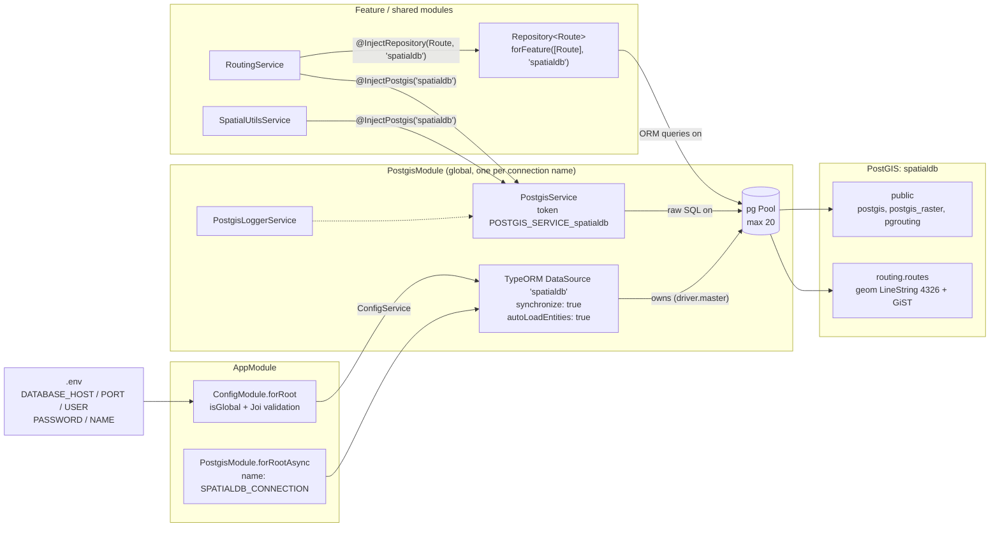
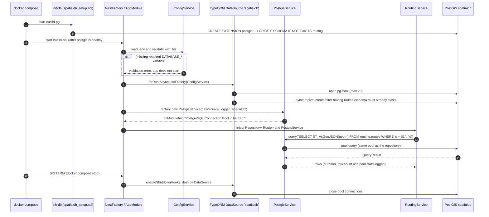
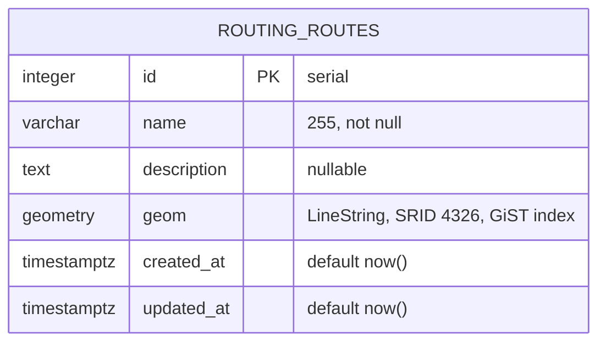

# feature/postgis-typeorm-connections: diagrams

Explained in words in [feature_postgis-typeorm-connection.md](./feature_postgis-typeorm-connection.md).

## 1. Module wiring and the shared pool (flowchart)
How one `PostgisModule.forRootAsync()` call becomes one pool, and how features reach it through TypeORM or raw SQL.

## 2. Startup, query and shutdown lifecycle (sequence diagram)
What happens in order when the `euclid-api` container starts, serves a raw PostGIS query, and stops.

## 3. Schema convention (ER view)
TypeORM's view of `spatialdb` after this branch. Every table belongs to an explicitly named schema, and `public` only hosts the extensions.

