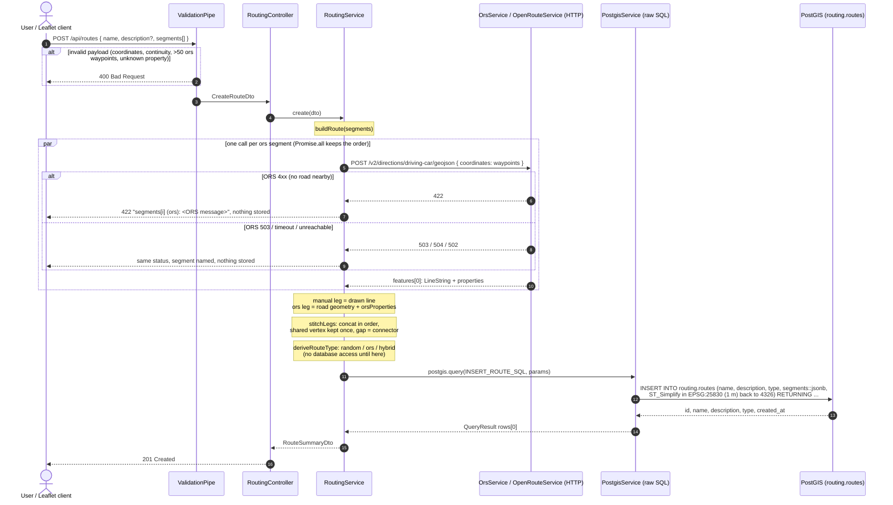
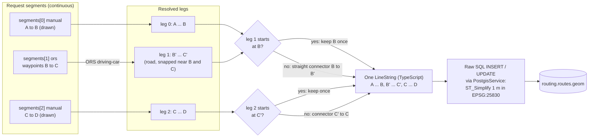
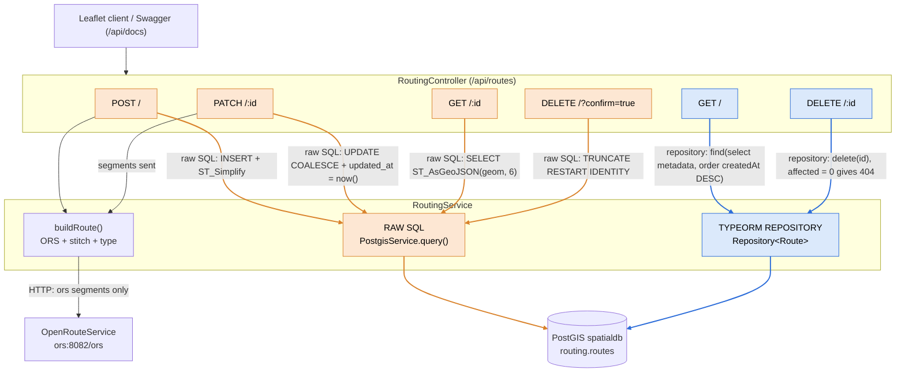
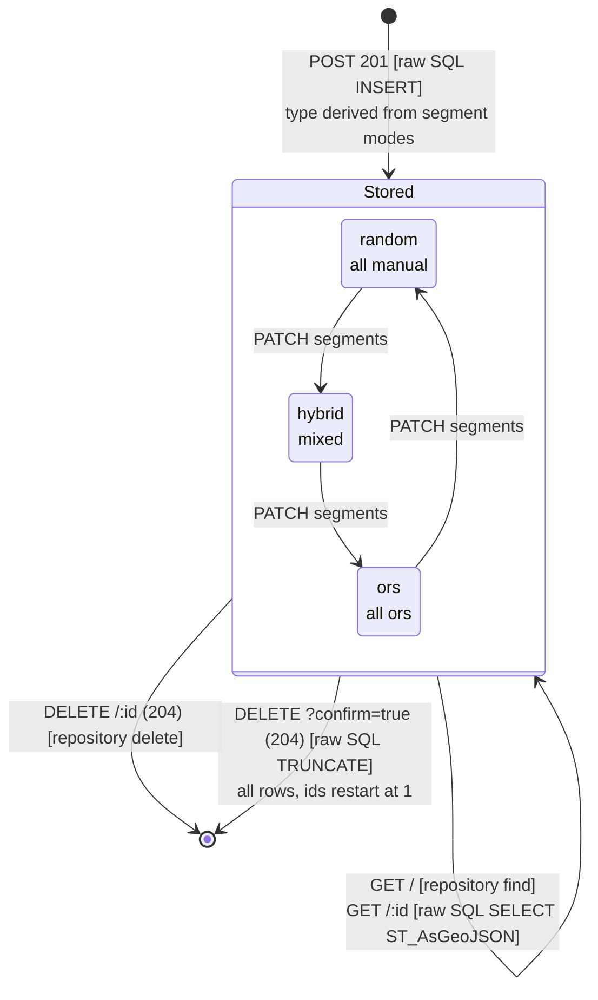
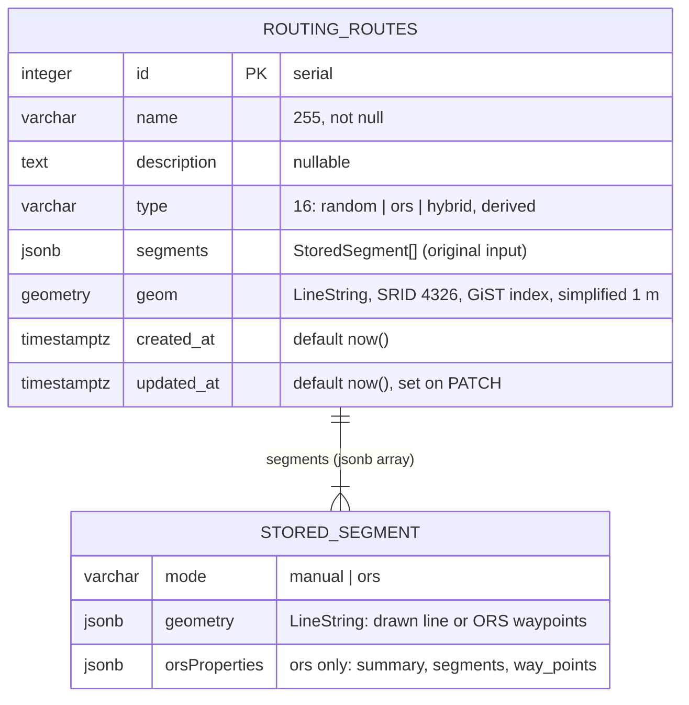

# feature/routes-crud: diagrams

Explained in words in [feature_routes-crud.md](./feature_routes-crud.md).

Database access in every diagram:
- **Raw SQL** (`PostgisService.query`): `create` (INSERT), `findOne` (SELECT `ST_AsGeoJSON`), `update` (UPDATE), `removeAll` (TRUNCATE).
- **TypeORM repository** (`Repository<Route>`): `findAll` (`find`), `remove` (`delete`).

Both use the same `spatialdb` pool. OpenRouteService is HTTP only and never touches the database.

## 1. Create a route: random, ors or hybrid (sequence diagram)
`POST /api/routes`, from validation to the stored row. The only database access is the final **raw SQL** `INSERT` through `PostgisService`; the TypeORM repository is not used. `PATCH /api/routes/:id` with `segments` follows the same path, but runs a raw SQL `UPDATE` at the end.

## 2. Stitching legs into one LineString (flowchart)
How `stitchLegs` joins the legs of a hybrid route, and why the result is always one line. Everything before the last step runs in TypeScript; only the simplify step is SQL (raw, through `PostgisService`).

## 3. Request and response flow for every endpoint (flowchart)
What each endpoint reads or writes, and through which access path. Orange arrows are **raw SQL** through `PostgisService`; blue arrows are the **TypeORM repository**. Both run on the same `spatialdb` pool.

## 4. Lifecycle of a stored route (state diagram)
What each operation does to one row, and to its `type`. Each transition names its access path: **raw SQL** (`PostgisService`) or **repository** (TypeORM).

## 5. Table after this branch (ER view)
`routing.routes` as created by TypeORM `synchronize` from the `Route` entity. `segments` holds the original input. Each stored segment has the following shape (it lives inside the jsonb column; it isn't a table):

